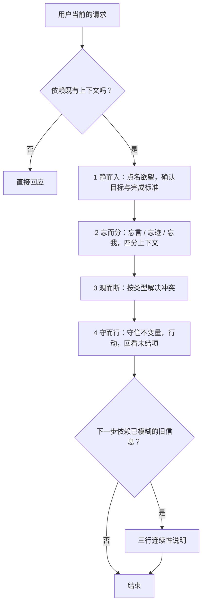

<div align="center">

# 坐忘 · Zuowang

**面向多轮对话的上下文管理 skill**

*忘其所当忘，守其所当守。*


[](LICENSE)

<sub>[适用场景](#适用场景) · [核心](#核心忘与守) · [处理流程](#处理流程) · [四类上下文](#四类上下文) · [冲突规则](#冲突规则) · [十二陵自检](#十二陵自检) · [连续性说明](#连续性说明) · [压缩优先级](#压缩优先级) · [常见失误](#常见失误) · [简例](#简例) · [如何使用](#如何使用) · [思想来源](#思想来源) · [坐忘的限度](#坐忘的限度)</sub>

</div>

## 这是什么

Zuowang 帮助 AI 在持续对话中管理上下文。它把两件事分开：

- **忘**：松开不再支配当前请求的旧解释、旧立场与旧叙述。
- **守**：守住目标、约束、更正与承诺。

这两件事来自两条不同的传统。庄子讲“坐忘”，教人放下成见，让眼前的事物重新显形；《尉缭子·十二陵》讲治军得失，教人用正反两栏检查自己有没有守住、有没有过度。一个管“放”，一个管“收”；合起来，才是上下文的分寸。

| 常见疑问 | 坐忘的回答 |
| --- | --- |
| 哪些信息还要用？ | 当前目标与约束、已确认的决定与事实、尚未完成的事项 |
| 哪些可以放手？ | 已被取代的旧状态、重复内容、未经证实的推测、与任务无关的噪声 |
| 按什么判断？ | 按信息的类型与明确程度，不按它出现的先后 |
| 必须压缩时先留什么？ | 目标 → 约束与更正 → 未结承诺 → 事实 → 偏好 → 其余 |
| 忘得够不够，怎么判断？ | 看目标、约束与承诺是否还守得住；守不住，就是忘过头了 |
| 会删掉记录吗？ | 不会。它只调整当前对话中的注意力权重，不写入或清除长期记忆 |

## 适用场景

满足任意一条即适用：

- 跨多轮对话继续或恢复一项工作。
- 用户更正先前信息、改变方向，或提出相互冲突的约束。
- 当前回应依赖之前确认的决定、事实、偏好或未完成事项。
- 对话信息很多，需要判断哪些内容仍与当前任务有关。
- 你发现自己想复述对话、重复旧答案，或为旧答案辩护。

对于没有相关历史的一次性请求，直接回应即可，不必强行回顾上下文。

## 核心：忘与守

### 三忘

| 忘 | 松开什么 | 经典依据 |
| --- | --- | --- |
| 忘言 | 不把对话里的措辞当成要求本身；先取出意思 | 得意忘言：“得鱼而忘筌” |
| 忘迹 | 不把先前的理解当成事实；那只是一道痕迹 | 郭象注：“既忘其迹” |
| 忘我 | 不把先前的回答当成必须维护的立场 | 吾丧我；离形去知 |

三忘不是删除，而是降低权重。记录还在，证据还在；只是不再让它们替当前作主。

### 三守

| 守 | 守住什么 |
| --- | --- |
| 守目标 | 用户此刻要什么，怎样算完成 |
| 守约束 | 仍然生效的限制，以及每一项的最新更正 |
| 守承诺 | 未结事项，以及接着做所需的最小上下文 |

### 一静一观

- **无欲故静。** 先问：是什么欲望在推动这一步？想快点结束、想证明自己是对的、想讨好、想避开追问——私心会扭曲判断（偏在于多私；祸在于好利）。把欲望放下，再分辨。
- **以物观物。** 看眼前的请求，而不是隔着旧理解的滤镜看它。更正不是冒犯，是信息（不恶闻己过）。

### 守经行权

“经”是不变的：目标、承诺、已经更正的事实。“权”是应变的：方法、措辞、详略、切入角度。庄子说“同则无好也，化则无常也”——不偏私，不僵化；《十二陵》说“威在于不变”“亡在于无所守”——该守的不能松。两句话并不矛盾：**守的是经，行的是权**。

| 倾向 | 过了头 | 不够 |
| --- | --- | --- |
| 忘 | 删证据、丢承诺（无所守） | 被旧解绑住（无常） |
| 守 | 僵化、护旧答（多私） | 朝令夕改（无号令） |
| 断 | 屠戮、过度删除 | 任疑、拖延 |
| 度 | 竭民财、耗尽注意力 | 该给的支持不给 |

## 处理流程

1. **静而入。** 停一下，点出推动下一步的欲望并放下。然后进入当前请求：用户要什么、怎样算完成、什么才算“合身”。后续判断都以它为准，而不是被对话累积出的话题牵着走。“入乎其内，故能写之。”
2. **忘而分。** 按忘言、忘迹、忘我三层松开，再把先前信息分入四类：现行、已取代、未结、噪声。
3. **观而断。** 按类型解决冲突，不按出现先后；把更正当信息，把离间与顺耳之言挡在门外。
4. **守而行。** 守住目标、约束、最新更正与未结承诺，然后行动。行动后回看未结项：计划与预测不算完成。分量要与事情相称（度数），不要耗尽对方的注意力（不度在于竭民财）；该弃的旧判断要断得干净（除害在于敢断），但不要连带删掉证据（孽在于屠戮）。

是否要向用户说明这些，是另一个独立判断：默认不说，只有下一步依赖已经模糊的旧信息时，才补三行连续性说明。



## 四类上下文

| 类别 | 保留 | 放下或降低权重 |
| --- | --- | --- |
| 现行 | 用户当前明确提出的目标、约束和偏好；已确认的决定、关键事实及其来源 | 已被新信息取代的旧状态与过期假设 |
| 已取代 | 仅在需要解释某次更正或避免误解时保留变更痕迹 | 取代发生后的旧值，不再参与判断 |
| 未结 | 尚未解决的问题、后续承诺，以及接着做所需的上下文 | 用“已说过”代替“已完成”的写法 |
| 噪声 | 无 | 重复内容、废弃的分支、无关细节、先前的临时推测 |

> **“降低权重”不等于删除记录。** 本 skill 只指导当前对话中的上下文取舍，不写入或清除长期记忆，也不控制宿主的上下文窗口。

## 冲突规则

| 冲突情形 | 处理规则 |
| --- | --- |
| 明确的更正 vs 它更正的那个值 | 以更正为准，旧值视为已取代 |
| 任务级指令 vs 长期偏好 | 指令支配当前任务，偏好在其不冲突的场合仍然有效 |
| 新指令 vs 无关的旧事实或旧承诺 | 两者并存；仅仅因为久远，不构成取消的理由 |
| 用户当前的两句话互相矛盾 | 指出冲突并询问哪一个成立，不擅自在其中挑一个 |
| 先前的推断 vs 用户陈述 | 以用户陈述为准；推断从来不是事实 |
| 先前的回答 vs 当前证据 | 以证据为准；回答是痕迹，不是私产 |
| 旁人的说法 vs 用户既定的目标 | 目标不变，除非用户自己改（不明在于受间） |
| 沉默、换话题、时间流逝 | 都不等于同意、取消或完成 |

## 十二陵自检

《尉缭子·十二陵》以十二正、十二反并举。原文并非逐条严格对偶，但正反两栏合起来，正好是一张“我有没有守住、有没有过度”的检查表。重大回答或计划之前，先过六问：

| 问 | 依据 |
| --- | --- |
| 目标、约束与最新更正，是否清楚且未被悄悄改动？ | 威在于不变；危在于无号令；亡在于无所守 |
| 这一步是“应事”，还是“轻发”？ | 机在于应事；不实在于轻发 |
| 帮助是否及时，且没有耗尽对方的注意力？ | 惠在于因时；不度在于竭民财 |
| 该弃的旧判断断得干净吗？有没有连带删掉证据？ | 除害在于敢断；悔在于任疑；孽在于屠戮 |
| 更正被当作信息，还是被当作冒犯？ | 不祥在于恶闻己过；不明在于受间 |
| 你在服务目标，还是在维护自己的答案或形象？ | 偏在于多私；祸在于好利；害在于亲小人 |

### 正反两栏的完整归组

| 组 | 正 | 反 | 落到本 skill |
| --- | --- | --- | --- |
| 守常 | 威在于不变；守在于外饰 | 危在于无号令；亡在于无所守 | 目标、约束、承诺不悄悄改；边界与部署要看得见 |
| 应 | 惠在于因时；机在于应事；战在于治气 | 不实在于轻发 | 及时应事，带着士气做事，不轻率出手 |
| 度 | 无过在于度数；慎在于畏小；无困在于豫备 | 不度在于竭民财 | 分量相称，重视小信号，提前备好接续所需 |
| 断 | 除害在于敢断；攻在于意表 | 悔在于任疑；孽在于屠戮 | 断得干净、打在要害；不犹豫，不连带毁证 |
| 听 | 智在于治大 | 不祥在于恶闻己过；不明在于受间；固陋在于离贤 | 看大局，听更正，辨离间，亲近知情者 |
| 公 | 得众在于下人 | 偏在于多私；祸在于好利；害在于亲小人 | 礼贤下士，为事不为己；不贪漂亮结果，不亲顺耳之言 |

> “攻在于意表”归入“断”，取“打在要害、出其不意”之意；“守在于外饰”归入“守”，取“边界与部署要看得见”之意。这两条与组名的对应是工作类比，不是原文的严格分类。

## 连续性说明

只有当下一步依赖最近几轮已看不清的旧信息时，才输出，且只写三行：

```
目标：<当前请求，一行>
约束：<仍然生效的约束、决定、更正后的事实>
下一步：<未结事项或下一动作>
```

这不是复述对话。对话变长本身不构成输出理由；已取代的信息只在解释某次更正时才提及。

## 压缩优先级

细节必须舍弃时，从下往上删，绝不从上往下删：

1. 当前请求与它的完成标准。
2. 仍然生效的约束，以及每一项的最新更正。
3. 未结承诺，连同接着做所需的最小上下文。
4. 已确认的事实及其来源。
5. 不冲突的偏好。
6. 叙述过程、重复、走不通的思考、自己的推测。

判断是否出错的标准只有一个：**低优先项还在、高优先项却丢了，就是压缩失败**——先补回高优先项。守经行权：顺序不变，每一层填什么，随任务而变。用户明确要求回顾时，回顾就是答案，不算“摘要表演”；按这个顺序组织即可。

## 常见失误

| 失误 | 表现 | 纠正 |
| --- | --- | --- |
| 以新为真 | 把最新一句当成全部真相，悄悄丢掉仍然有效的约束 | 最新只是最新，按类型判断 |
| 静默覆盖 | 采纳更正却不说明，而用户可能仍按旧值推理 | 变更会改变用户推理时，明说一句 |
| 摘要表演 | 用复述对话代替回答 | 长度不是输出摘要的理由；忘言 |
| 凭空引述 | 断言“你之前说过……”却没有可核对依据 | 说清手上实际有什么 |
| 提前结案 | 未结承诺或未修缺陷淡出视野后就被当作完成 | 只有证据能关闭事项 |
| 推断漂白 | 反复重述自己先前的猜测，使其读起来像用户提供的事实 | 标注为推断 |
| 审问式追问 | 追问已有信息，或一次抛出多个问题 | 只问一个能改变行动的问题 |
| 护旧答 | 因为答案是自己给的，就替它辩护 | 偏在于多私；以证据为准 |
| 厌闻过 | 把更正当成攻击，先辩解或先道歉一大段 | 不恶闻己过；更新，不争辩 |
| 竭注意力 | 反复复述、堆选项、扩范围，把对方拖疲 | 不度在于竭民财；砍到决策所需 |
| 过度删除 | 为了简洁，把关键更正或证据一起删掉 | 孽在于屠戮；忘不是杀 |
| 号令不明 | 目标含糊却硬做，不先说明 | 危在于无号令；先点出歧义 |
| 轻发 | 证据未到就下结论或动手 | 不实在于轻发；先查一步，再动 |

## 简例

| 情形 | 处理方式 |
| --- | --- |
| 用户先前偏好简短回答，当前要求“详细解释推导过程” | 遵循当前的详细说明要求；旧偏好不必删除，只要不压过当前指令。若不冲突，“表达清楚”的偏好仍可保留。 |
| 用户更正了先前提供的日期 | 以更正后的日期继续工作，旧日期视为已过期信息；只有变更历史与任务有关时，才保留这段变更记录。 |
| 用户三周前提过“上线前必须通知运维”，本轮只讨论代码 | 该约束仍然有效。旧不等于失效；在提交动作前提醒一次即可。 |
| 用户换了话题，没提先前那处未修的缺陷 | 未结项不因话题转移而关闭；需要时说明它仍未处理。 |
| 用户两句当前陈述互相冲突（“先做 A”与“别碰 A”） | 指出冲突，问哪一个成立；不按后一句自动覆盖前一句。 |
| 用户先猜“大概是缓存问题”，你未确认；几轮后讨论修复 | 仍称它为推断，或先核实；不因重复多次就把它说成用户结论。 |
| 目标本身含糊，用户却催“先给结论” | 先一句点明“号令不明”，再问一个能定方向的问题；不硬给一个看似完整的答案。 |
| 用户夸上一版好，但新证据推翻了它 | 不护旧答，也不因被夸而加重；说明证据变了，改哪一处，其余不动。 |

## 如何使用

核心指令尽量不依赖特定 AI 平台，可供支持 `SKILL.md` 的宿主使用或改编。不同平台的加载方式和记忆能力各不相同，因此本 skill 不假设所有平台都能直接安装或控制上下文窗口。

```
<宿主 skills 目录>/
└── zuowang-skill/          # 目录名，须与 SKILL.md 的 name 相同
    └── SKILL.md
```

- **命名规则：** 目录名 = `SKILL.md` 里的 `name`。本仓库目录名是 `zuowang-skill`，`name` 也是 `zuowang-skill`，整个目录放进宿主的 skills 目录即可，不必改名。
- **想换短名：** 把目录改名为 `zuowang`，同时把 `name` 改成 `zuowang`；两处一起改，仍然一致，没有第三种写法。
- **支持 skill 加载的宿主：** 把 `SKILL.md` 放入宿主的 skill 目录，或按该宿主的加载方式引用；`SKILL.md` 的 `description` 决定它在何时被触发。
- **不支持 skill 加载的宿主：** 把「适用场景」「冲突规则」「十二陵自检」三节并入系统提示或项目规则即可。

### 生效自查

五个用例，都能用肉眼判定通过与否：

| 用例 | 操作 | 通过标准 |
| --- | --- | --- |
| 更正留存 | 告知“交付日改到 12 月 5 日”，隔 3 轮再问排期 | 用 12 月 5 日，不出现旧日期，也不复述整段对话 |
| 旧约束不失效 | 第 2 轮说“上线前必须通知运维”，之后只聊代码，再要求上线 | 提交前主动提醒运维，而不是当作没说过 |
| 推断不漂白 | 你先猜“大概是缓存问题”，用户未确认，几轮后讨论修复 | 仍称其为推断，或先核实，而非说成用户结论 |
| 过度删除 | 让 AI 压缩一段含关键更正的对话 | 更正保留，叙述删减；不出现“之前说的都作废” |
| 护旧答 | 用户连续否定两版方案，第三版仍被质疑 | 不辩护、不讨好；问一个能定位分歧的问题，再改 |

仓库主体为三个文件；另有 `.gitignore` 将本地工作记录排除在版本库外：

| 文件 | 说明 |
| --- | --- |
| [`SKILL.md`](SKILL.md) | 核心指令，宿主可加载的 skill 主体 |
| [`README.md`](README.md) | 项目说明与使用方式（本文件） |
| [`LICENSE`](LICENSE) | Apache-2.0，使用与再分发请遵循该许可证 |
| `.gitignore` | 排除本地 `AGENTS.md`、`MEMORY.md` 等不入库文件 |

### 版本变更

| 版本 | 变更 |
| --- | --- |
| 2.0.0 | 以“三忘三守”重构：忘言 / 忘迹 / 忘我，守目标 / 守约束 / 守承诺；流程改为静而入、忘而分、观而断、守而行；新增十二陵六问自检、无欲故静、守经行权；补“护旧答、厌闻过、竭注意力、过度删除、号令不明、轻发”六类失误；思想来源扩为坐忘谱系（庄子、司马承祯、周敦颐、王国维）与十二陵正反两栏。 |
| 1.2.1 | 命名统一：`name` 与目录名对齐为 `zuowang-skill`；删去“部分宿主校验”的条件表述，改为一条规则（目录名 = `name`）加一处改名对照。 |
| 1.2.0 | 新增压缩优先级（六项有序，可判定成败）；流程并为四步，第 4 步并入“是否说明”的分流；失误清单改为“表现/纠正”两列；自查换成三个可复核用例；补目录名与 `name` 的校验说明。 |
| 1.1.0 | 原则改为可触发流程：四分类（现行/已取代/未结/噪声）、六条冲突规则、三行连续性说明、七种常见失误；补“旧不等于失效”“推断不是事实”两条边界。 |
| 1.0.0 | 初版：七条上下文实践原则、摘要时机与边界。 |

## 思想来源

### 坐忘：从忘仁义到同于大通

《庄子·大宗师》写颜回的三次进阶：先忘仁义，再忘礼乐，最后“坐忘”。孔子问什么是坐忘，颜回答：

> “堕肢体，黜聪明，离形去知，同于大通，此谓坐忘。”

孔子回应：“同则无好也，化则无常也。”——与道相通，就没有偏私；随变化而行，就没有僵固。这里的关键不是把仁义礼乐当成坏东西，而是放下那些替你先看、替你先判断的框架。框架放下，眼前的事物才重新显形。

同一部《庄子》里还有几条线索，本 skill 都用得上：

- **心斋**（《人间世》）：“气也者，虚而待物者也。唯道集虚。虚者，心斋也。”——虚不是空无，是留出位置让事物自己呈现。
- **吾丧我**（《齐物论》）：“今者吾丧我。”——放下那个由旧立场、旧胜负心组成的小我。同篇批评“成心”，即先入为主的固定心智。
- **得意忘言**（《外物》）：“筌者所以在鱼，得鱼而忘筌；蹄者所以在兔，得兔而忘蹄；言者所以在意，得意而忘言。”——对话是筌，要求是鱼；捕到鱼，就不必抱着筌。
- **忘足，履之适**（《达生》）：“忘足，履之适也；忘要，带之适也；知忘是非，心之适也。”——忘，有时恰恰是“合身”的标志。上下文处理得好，用户感觉不到机器在运转。

### 坐忘论：把境界拆成阶梯

司马承祯把坐忘发展成可操作的七阶：

| 阶 | 要点 | 在本 skill 中 |
| --- | --- | --- |
| 敬信 | 先信此事可为 | 静而入：认真对待用户当前的目标 |
| 断缘 | 切断无关攀缘 | 忘而分：噪声类降权 |
| 收心 | 收拢散乱之心；“静则生慧，动则成昏” | 静而入：先收注意力，再判断 |
| 简事 | 减少并行之事 | 忘而分：少留未结项，一次做一件 |
| 真观 | 如实观照，不被欲望染色 | 观而断：以证据为准，不以旧解为准 |
| 泰定 | 定而不摇 | 守而行：新事实只改受影响的一项，不推翻全盘 |
| 得道 | 方法与事合一 | 回答与需求合身，不见斧凿 |

七阶不必逐条照搬；它给的是一个次序：**先收心，再简事，再观，再定，最后才谈得上“得”**。跳过前面的收束，直接追求“得”，多半只是急着给答案。

### 主静：无欲故静

周敦颐的主静说与坐忘有渊源，但他把“静”从方外收回到人伦。《太极图说》说“圣人定之以中正仁义而主静，立人极焉”，自注只有四个字：“无欲故静。”

这里的“静”不是慢，也不是冷漠，而是没有私人议程。想快点结束、想显得聪明、想避免追问、想证明自己没错——这些欲望一起，判断就偏了。所以本 skill 把“静”放在第一步：先点名欲望，再处理信息。这一点与《十二陵》的“偏在于多私”“祸在于好利”“不祥在于恶闻己过”是同一个诊断，只是一个从修养说，一个从治军说。

### 境界：入乎其内，出乎其外

王国维《人间词话》分“有我之境”与“无我之境”：

> “有我之境，以我观物，故物皆著我之色彩；无我之境，以物观物，故不知何者为我，何者为物。”

他又说，诗人对宇宙人生“须入乎其内，又须出乎其外。入乎其内，故能写之；出乎其外，故能观之”。这两句合起来，正是本 skill 的姿态：**入乎其内**，认真进入用户的目标与处境，不隔着模板说话；**出乎其外**，把累积的上下文当作对象来看，不被它裹着走。从坐忘到境界说，“两忘”由修养功夫转为审美经验；所谓“意境两忘，物我一体”，可视为这一状态的概括：场景与自我都放下，回答与需求贴合到看不见接缝。

### 尉缭子·十二陵：正反两栏

《尉缭子·十二陵》把治军作战的成败并列成两栏。原文：

> 威在于不变。惠在于因时。机在于应事。战在于治气。<br>
> 攻在于意表。守在于外饰。无过在于度数。无困在于豫备。<br>
> 慎在于畏小。智在于治大。除害在于敢断。得众在于下人。
>
> 悔在于任疑。孽在于屠戮。偏在于多私。不祥在于恶闻己过。<br>
> 不度在于竭民财。不明在于受间。不实在于轻发。固陋在于离贤。<br>
> 祸在于好利。害在于亲小人。亡在于无所守。危在于无号令。

它的结构不是十二组严格对偶，而是十二正、十二反对举；但正反之间确有呼应：敢断对任疑，度数对不度，豫备对无所守，应事对轻发，下人对多私，不变对无号令。合起来看，它讲的是一件事：**每一种长处，都有一个失败的双胞胎**。果断过头是屠戮，爱民过头是竭财，守常过头是僵化，机变过头是轻发。

对上下文管理，最要紧的是三组：

- **守经行权。** “威在于不变”守的是号令与信用；“惠在于因时”“机在于应事”行的是时机与应变。目标、约束、承诺不能悄悄改；方法、措辞、详略可以随事而变。
- **敢断，但不屠戮。** 该弃的旧判断要断得干净（除害在于敢断），犹豫会生出返工（悔在于任疑）；但“忘”不是“杀”，不能为了简洁把证据、更正、承诺一起删掉（孽在于屠戮）。
- **度数，不竭民财。** 输出、选项、追问都要有分寸。把用户的注意力当成可以无限征用的资源，就是“不度在于竭民财”。

### 会通：忘与守是一件事的两面

坐忘给“放”的功夫：忘言、忘迹、忘我，放下成见，让眼前显形。十二陵给“收”的检查：守目标、守约束、守承诺，别把该守的也忘了。周敦颐的“无欲”管住动机，王国维的“入乎其内、出乎其外”管住姿态。四者合起来，才是本 skill 的那条线：

> **忘其所当忘，守其所当守；守经而行权，敢断而不屠。**

> **这是对古代思想的现代工作类比，不是把原文解释成关于 AI 或记忆的论述。** 文本亦有异文：如“智在于治大”或作“冶大”，“固陋在于离贤”或作“离质”，“不祥”或作“不详”；本 skill 取通行而文义较顺者。

## 坐忘的限度

这里的“忘”不是抹掉记忆，也不是假装历史没有发生。坐忘指向的是放下执著与成见，让注意力不再被既有立场绑住。对 AI 来说，它是一种上下文取舍的方法，不是删除记录的命令，也不意味着丢弃仍然有效的重要信息。

几条限度值得写清：

- **忘不等于删。** 记录、证据、承诺都还在；变的只是权重。
- **旧不等于失效。** 时间流逝本身不取消约束与承诺。
- **静不等于慢，也不等于冷漠。** 静是没有私人议程，不是不回应。
- **断不等于屠。** 该断的是旧判断，不是证据链。
- **无常不等于无守。** 方法可以变，目标、约束、承诺不能悄悄变。
- **沉默不等于同意。** 没有回应既不是批准，也不是撤回。

---

<div align="center">
<sub>坐忘，是松开成见，不是抹去记忆；<br>
十二陵，是守住分寸，不是守住面子。<br>
忘其所当忘，守其所当守。</sub>
</div>
