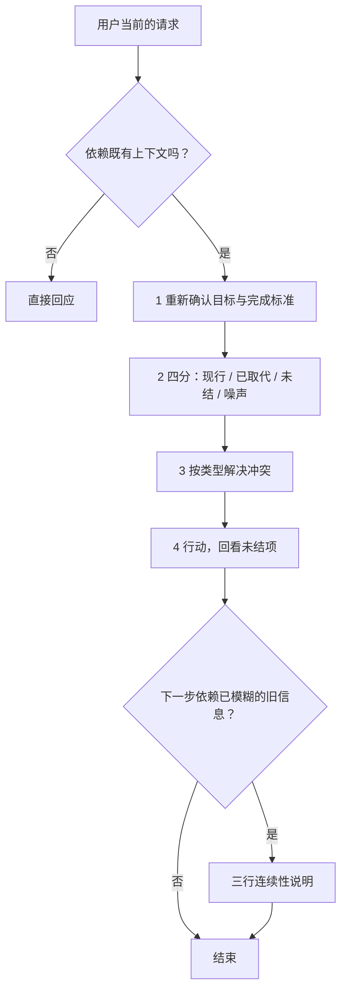

<div align="center">

# 坐忘 · Zuowang

**面向多轮对话的上下文管理 skill**

*松开过时判断，保留推进当前目标所需的信息。*


[](LICENSE)

<sub>[适用场景](#适用场景) · [处理流程](#处理流程) · [冲突规则](#冲突规则) · [上下文管理](#上下文管理) · [连续性说明](#连续性说明) · [压缩优先级](#压缩优先级) · [常见失误](#常见失误) · [简例](#简例) · [如何使用](#如何使用) · [思想来源](#思想来源) · [坐忘的限度](#坐忘的限度)</sub>

</div>

## 这是什么

Zuowang 帮助 AI 在持续对话中管理上下文：重新确认用户当前的目标，保留仍然有效的决定与约束，并降低过期、重复或无关信息的权重。

| 常见疑问 | 坐忘的回答 |
| --- | --- |
| 哪些信息还要用？ | 用户当前的目标与约束、已确认的决定与事实、尚未完成的事项 |
| 哪些可以放手？ | 已被取代的旧状态、重复内容、未经证实的推测、与任务无关的噪声 |
| 按什么判断？ | 按信息的类型与明确程度，不按它出现的先后 |
| 必须压缩时先留什么？ | 目标 → 约束与更正 → 未结承诺 → 事实 → 偏好 → 其余 |
| 会删掉记录吗？ | 不会。它只调整当前对话中的注意力权重，不写入或清除长期记忆 |

## 适用场景

满足任意一条即适用：

- 跨多轮对话继续或恢复一项工作。
- 用户更正先前信息、改变方向，或提出相互冲突的约束。
- 当前回应依赖之前确认的决定、事实、偏好或未完成事项。
- 对话信息很多，需要判断哪些内容仍与当前任务有关。

对于没有相关历史的一次性请求，直接回应即可，不必强行回顾上下文。

## 处理流程

1. **重新确认当前目标。** 说清用户此刻要什么、怎样算完成；后续判断都以它为准，而不是被对话累积出的话题牵着走。
2. **把先前信息分入四类。** 现行（继续沿用）、已取代（退出画面）、未结（保留到能接着做）、噪声（降低权重）。
3. **按类型解决冲突。** 见下节；新旧顺序本身不构成理由。
4. **行动并回看未结项。** 计划与预测不算完成，淡出视野的未结项仍然未结。是否要向用户说明，是另一个独立判断：默认不说，只有下一步依赖已经模糊的旧信息时才补三行说明。



## 冲突规则

| 冲突情形 | 处理规则 |
| --- | --- |
| 明确的更正 vs 它更正的那个值 | 以更正为准，旧值视为已取代 |
| 任务级指令 vs 长期偏好 | 指令支配当前任务，偏好在其不冲突的场合仍然有效 |
| 新指令 vs 无关的旧事实或旧承诺 | 两者并存；仅仅因为久远，不构成取消的理由 |
| 用户当前的两句话互相矛盾 | 指出冲突并询问哪一个成立，不擅自在其中挑一个 |
| 先前的推断 vs 用户陈述 | 以用户陈述为准；推断从来不是事实 |
| 沉默、换话题、时间流逝 | 都不等于同意、取消或完成 |

## 上下文管理

| 类别 | 保留 | 放下或降低权重 |
| --- | --- | --- |
| 现行 | 用户当前明确提出的目标、约束和偏好；已确认的决定、关键事实及其来源 | 已被新信息取代的旧状态与过期假设 |
| 已取代 | 仅在需要解释某次更正或避免误解时保留变更痕迹 | 取代发生后的旧值，不再参与判断 |
| 未结 | 尚未解决的问题、后续承诺，以及接着做所需的上下文 | 用“已说过”代替“已完成”的写法 |
| 噪声 | 无 | 重复内容、废弃的分支、无关细节、先前的临时推测 |

> **“降低权重”不等于删除记录。** 本 skill 只指导当前对话中的上下文取舍，不写入或清除长期记忆，也不控制宿主的上下文窗口。

## 连续性说明

只有当下一步依赖最近几轮已看不清的旧信息时，才输出，且只写三行：

```
目标：<当前请求，一行>
约束：<仍然生效的约束、决定、更正后的事实>
下一步：<未结事项或下一动作>
```

这不是复述对话。对话变长本身不构成输出理由；已取代的信息只在解释某次更正时才提及。

## 压缩优先级

细节必须舍弃时，从下往上删，绝不从上往下删：

1. 当前请求与它的完成标准。
2. 仍然生效的约束，以及每一项的最新更正。
3. 未结承诺，连同接着做所需的最小上下文。
4. 已确认的事实及其来源。
5. 不冲突的偏好。
6. 叙述过程、重复、走不通的思考、自己的推测。

判断是否出错的标准只有一个：**低优先项还在、高优先项却丢了，就是压缩失败**——先补回高优先项。

## 常见失误

| 失误 | 表现 | 纠正 |
| --- | --- | --- |
| 以新为真 | 把最新一句当成全部真相，悄悄丢掉仍然有效的约束 | 最新只是最新，按类型判断 |
| 静默覆盖 | 采纳更正却不说明，而用户可能仍按旧值推理 | 变更会改变用户推理时，明说一句 |
| 摘要表演 | 用复述对话代替回答 | 长度不是输出摘要的理由 |
| 凭空引述 | 断言“你之前说过……”却没有可核对依据 | 说清手上实际有什么 |
| 提前结案 | 未结承诺或未修缺陷淡出视野后就被当作完成 | 只有证据能关闭事项 |
| 推断漂白 | 反复重述自己先前的猜测，使其读起来像用户提供的事实 | 标注为推断 |
| 审问式追问 | 追问已有信息，或一次抛出多个问题 | 只问一个能改变行动的问题 |

## 简例

| 情形 | 处理方式 |
| --- | --- |
| 用户先前偏好简短回答，当前要求“详细解释推导过程” | 遵循当前的详细说明要求；旧偏好不必删除，只要不压过当前指令。若不冲突，“表达清楚”的偏好仍可保留。 |
| 用户更正了先前提供的日期 | 以更正后的日期继续工作，旧日期视为已过期信息；只有变更历史与任务有关时，才保留这段变更记录。 |
| 用户三周前提过“上线前必须通知运维”，本轮只讨论代码 | 该约束仍然有效。旧不等于失效；在提交动作前提醒一次即可。 |
| 用户换了话题，没提先前那处未修的缺陷 | 未结项不因话题转移而关闭；需要时说明它仍未处理。 |
| 用户两句当前陈述互相冲突（“先做 A”与“别碰 A”） | 指出冲突，问哪一个成立；不按后一句自动覆盖前一句。 |

## 如何使用

核心指令尽量不依赖特定 AI 平台，可供支持 `SKILL.md` 的宿主使用或改编。不同平台的加载方式和记忆能力各不相同，因此本 skill 不假设所有平台都能直接安装或控制上下文窗口。

```
<宿主 skills 目录>/
└── zuowang-skill/          # 目录名，须与 SKILL.md 的 name 相同
    └── SKILL.md
```

- **命名规则：** 目录名 = `SKILL.md` 里的 `name`。本仓库目录名是 `zuowang-skill`，`name` 也是 `zuowang-skill`，整个目录放进宿主的 skills 目录即可，不必改名。
- **想换短名：** 把目录改名为 `zuowang`，同时把 `name` 改成 `zuowang`；两处一起改，仍然一致，没有第三种写法。
- **支持 skill 加载的宿主：** 把 `SKILL.md` 放入宿主的 skill 目录，或按该宿主的加载方式引用；`SKILL.md` 的 `description` 决定它在何时被触发。
- **不支持 skill 加载的宿主：** 把「适用场景」与「冲突规则」两节并入系统提示或项目规则即可。

### 生效自查

三个用例，都能用肉眼判定通过与否：

| 用例 | 操作 | 通过标准 |
| --- | --- | --- |
| 更正留存 | 告知“交付日改到 12 月 5 日”，隔 3 轮再问排期 | 用 12 月 5 日，不出现旧日期，也不复述整段对话 |
| 旧约束不失效 | 第 2 轮说“上线前必须通知运维”，之后只聊代码，再要求上线 | 提交前主动提醒运维，而不是当作没说过 |
| 推断不漂白 | 你先猜“大概是缓存问题”，用户未确认，几轮后讨论修复 | 仍称其为推断，或先核实，而非说成用户结论 |

仓库内共三个文件：

| 文件 | 说明 |
| --- | --- |
| [`SKILL.md`](SKILL.md) | 核心指令，宿主可加载的 skill 主体 |
| [`README.md`](README.md) | 项目说明与使用方式（本文件） |
| [`LICENSE`](LICENSE) | Apache-2.0，使用与再分发请遵循该许可证 |

### 版本变更

| 版本 | 变更 |
| --- | --- |
| 1.2.1 | 命名统一：`name` 与目录名对齐为 `zuowang-skill`；删去“部分宿主校验”的条件表述，改为一条规则（目录名 = `name`）加一处改名对照。 |
| 1.2.0 | 新增压缩优先级（六项有序，可判定成败）；流程并为四步，第 4 步并入“是否说明”的分流；失误清单改为“表现/纠正”两列；自查换成三个可复核用例；补目录名与 `name` 的校验说明。 |
| 1.1.0 | 原则改为可触发流程：四分类（现行/已取代/未结/噪声）、六条冲突规则、三行连续性说明、七种常见失误；补“旧不等于失效”“推断不是事实”两条边界。 |
| 1.0.0 | 初版：七条上下文实践原则、摘要时机与边界。 |

## 思想来源

### 坐忘：松开成见

它借用《庄子·大宗师》中“坐忘”的意象，提醒 AI 不要被旧判断、惯性解释和无关细节牵着走；每次回应前，都应重新辨认眼前的目标与重要事实。

> 颜回曰：“堕肢体，黜聪明，离形去知，同于大通，此谓坐忘。”——《庄子·大宗师》

原文见[《庄子·大宗师》](https://ctext.org/zhuangzi/great-and-most-honoured-master/zhs)。

### 尉缭子·十二陵：应变、预备、慎小

《尉缭子·十二陵》将行事的得失并举。这里借它提醒实践中的几件事：适时应变、预先准备、留心小处、听取纠错，避免轻率行动。以下为本 skill 采用的文本：

> 威在于不变。惠在于因时。机在于应事。战在于治气。<br>
> 攻在意表。守在于外饰。无过在于度数。无困在于豫备。<br>
> 慎在于畏小。智在于治大。除害在于敢断。得众在于下人。
>
> 悔在于任疑。孽在于屠戮。偏在于多私。不详在于恶闻己过。<br>
> 不度在于竭民财。不明在于受间。不实在于轻发。固陋在于离贤。<br>
> 祸在于好利。害在于亲小人。亡在于无所守。危在于无号令。

《尉缭子·十二陵》文本可参见[《尉缭子》全文](https://youraikanban.com/p/weiliaozi-hans.html)。

对 AI 上下文管理的启发是：随当前任务调整注意力，同时保持目标与有效约束稳定。几个关键用语落到具体做法上：

| 原文用语 | 在上下文管理中的含义 | 对应做法 |
| --- | --- | --- |
| 因时、应事 | 以当前请求为准，随时势调整注意力 | 处理流程第 1 步 |
| 豫备 | 提前保留完成任务所需的信息 | 未结类保留可接着做的上下文 |
| 畏小 | 重视小的更正与风险信号 | 冲突规则第 1 条；不静默覆盖 |
| 不恶闻己过 | 听取用户反馈，并据此修正错误 | 推断让位于用户陈述 |
| 不轻发 | 信息不足时，避免轻率断言或行动 | 校准：一句不确定 + 一个问题 |
| 无过在于度数 | 分寸感：留下该留的，放下该放的 | 四分类的边界 |
| 亡在于无所守 | 压缩时可以删细节，不能丢目标与约束 | 压缩优先级 |

> **这是对古代兵家格言的现代工作类比，不是将原文解释成关于 AI 或记忆的论述。**

## 坐忘的限度

这里的“忘”不是抹掉记忆，也不是假装历史没有发生。坐忘指向的是放下执著与成见，让注意力不再被既有立场绑住。对 AI 来说，它是一种上下文取舍的方法，不是删除记录的命令，也不意味着丢弃仍然有效的重要信息。

另外两条限度值得写清：**旧不等于失效**——时间流逝本身不取消约束与承诺；**沉默不等于同意**——没有回应既不是批准，也不是撤回。

---

<div align="center">
<sub>坐忘，是松开成见，不是抹去记忆；<br>
是让上下文服务于当下目标，而不是让过去替当下作主。</sub>
</div>
